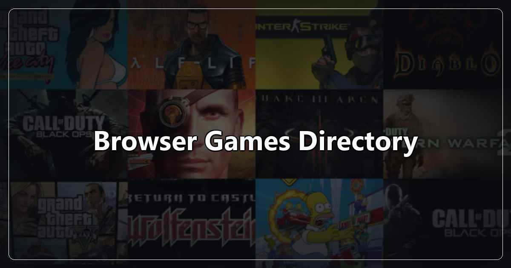

# Browser Games Directory

A curated collection of 34 classic, retro, and web-ported games preserved to run directly inside modern web browsers.

Every title in this archive executes entirely client-side using WebAssembly (WASM), WebGL, and JavaScript web engines, requiring zero downloads, emulators, or browser plugins.

---

## Catalog

| # | Game Name | Category |
| :-: | :--- | :--- |
| 01 | Black Ops 1 Zombies | Shooter |
| 02 | Black Ops 2 | Shooter |
| 03 | Black Ops 3 Cheese Cube | Shooter |
| 04 | Call of Duty: World at War Zombies (Nacht der Untoten) | Shooter |
| 05 | Command & Conquer: Generals Zero Hour | Strategy / RTS |
| 06 | Command & Conquer: Red Alert 2 | Strategy / RTS |
| 07 | Counter-Strike 1.6 | Tactical Shooter |
| 08 | CS Surf | Movement / FPS |
| 09 | Crash Bash Online | Party / Arcade |
| 10 | Diablo | Action RPG |
| 11 | GTA 5 | Open World |
| 12 | GTA Chinatown Wars | Open World |
| 13 | GTA III | Open World |
| 14 | GTA Vice City | Open World |
| 15 | Half-Life | Sci-Fi Shooter |
| 16 | Halo: Combat Evolved | Sci-Fi Shooter |
| 17 | Halo CE Mobile | Sci-Fi Shooter |
| 18 | Hedgewars | Turn-Based Strategy |
| 19 | Kino der Toten | Shooter |
| 20 | LEGO Island | Adventure |
| 21 | Minecraft 1.8.8 | Sandbox / Survival |
| 22 | Modern Warfare 2 | Shooter |
| 23 | Moon (Black Ops Zombies) | Shooter |
| 24 | Pepsiman | Action Runner |
| 25 | PES 6 | Sports / Football |
| 26 | Quake 1 / QuakeWorld | Arena Shooter |
| 27 | Quake 2 | Arena Shooter |
| 28 | Quake 3 | Arena Shooter |
| 29 | Return to Castle Wolfenstein | Tactical Shooter |
| 30 | Skate 3 | Extreme Sports |
| 31 | Skate Rust | Extreme Sports |
| 32 | The Binding of Isaac: Repentance+ | Roguelike |
| 33 | The Simpsons: Hit & Run | Action / Adventure |
| 34 | Urban Terror | Tactical Shooter |

---

## About

All titles in this directory are powered by community source ports and WebAssembly compilation projects. Trademarks, original game assets, and copyrights belong to their respective creators and publishers.
